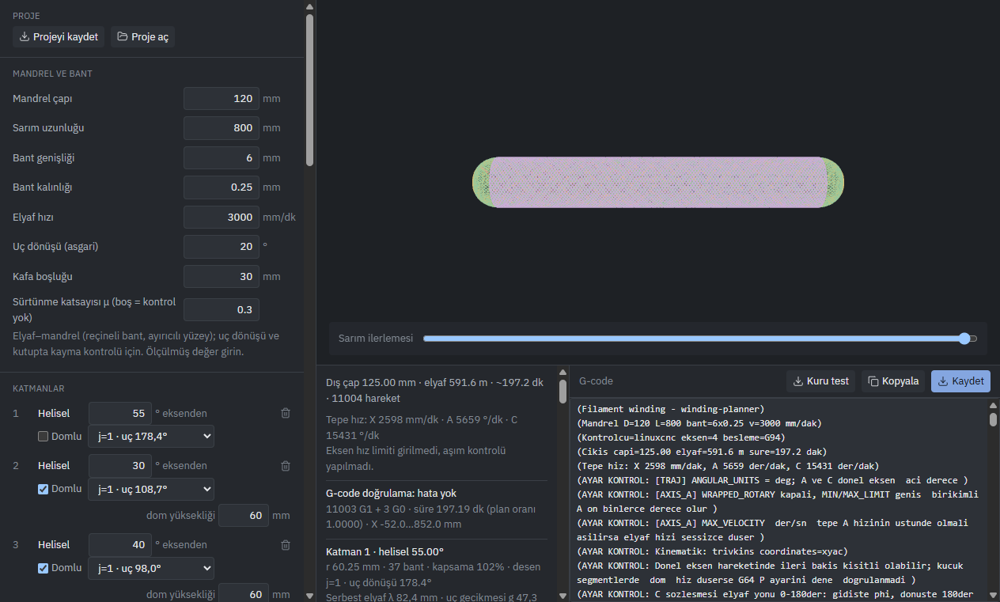

# Winding Planner

Karbon fiber filament winding (elyaf sarma) makineleri için G-code üreten Windows masaüstü uygulaması. Hedef kontrolcüler **LinuxCNC** ve **Mach3**. Düz silindirik tüp üzerinde helisel ve hoop katmanlar, iki uçta yarım-elips dom üzerinden geodezik (Clairaut) helisel sarım. Yereldir: sunucu, hesap veya bulut yoktur.



## Önemli uyarı: makinede doğrulanmadı

Bu programın ürettiği G-code **hiçbir gerçek makinede denenmedi**. Hesaplar ve G-code biçimi testlerle ve bağımsız bir doğrulayıcıyla kontrol edildi. Bu, programın makinede doğru çalışacağını göstermez.

- İlk kullanımda programı **elyafsız ve mandrelsiz, havada kuru çalıştırın**: eksen yönleri, A ekseninin derece birimi, C açısı ve besleme (F) yorumu kontrol edilmeli. Uygulamadaki "Kuru test" programı bu iş için.
- Sonra düşük hızda, elyafla, "Deneme programı (ilk k devre)" ile kısa bir deneme yapın.
- Domlu katmanlarda X negatif değerlere iner (ayna/punta bölgesi). X strok sınırlarını makinenize göre girin. Program bu sınırlar olmadan domlu G-code üretmez.

## Kurulum (Windows)

1. GitHub Releases sayfasından `winding-planner-<sürüm>-setup.exe` dosyasını indirin.
2. Çalıştırın. Kurulum dosyası **imzasız** olduğu için Windows SmartScreen "Windows bilgisayarınızı korudu" uyarısı gösterir: **Ek bilgi → Yine de çalıştır**.
3. Kurulum dizinini seçebilirsiniz. Kurulum masaüstü ve Başlat menüsü kısayolu oluşturur. Kaldırmak için Ayarlar → Uygulamalar → "Winding Planner".

## Kaynaktan çalıştırma

Node.js 22 veya üstü gerekir.

```
npm install
npm run dev        # geliştirme (Electron penceresi)
npm test           # çekirdek hesap ve G-code testleri (vitest)
npm run typecheck
npm run build:win  # Windows kurulum dosyası -> dist/
```

VS Code terminalinde `ELECTRON_RUN_AS_NODE=1` ayarlıysa Electron düz Node gibi çalışır. Bu durumda değişkeni kaldırıp başlatın (Git Bash: `env -u ELECTRON_RUN_AS_NODE npm run dev`).

## Temel kullanım

1. **Mandrel ve bant:** mandrel çapı, sarım uzunluğu, bant genişliği ve kalınlığı, elyaf hızı, asgari uç dönüşü. Hiçbir ölçünün varsayılan değeri yoktur. Boş alan varsa program "eksik alanlar" listesini gösterir ve G-code üretmez.
2. **Katmanlar:** helisel (açı, isteğe bağlı dom ve dom yüksekliği, desen atlaması j) veya hoop.
3. **Makine:** kontrolcü (LinuxCNC/Mach3), 3 eksen (X araba, A mandrel, C kafa) veya 4 eksen (+ Y radyal), eksen adları ve yön tersleme, besleme kipi (G94/G93), C açı sözleşmesi, strok, hız ve ivme limitleri (boş bırakılan limit kontrol edilmez).
4. Sağdaki panelde önizleme, katman bilgileri ve uyarılar (kayma, serbest elyaf, kalınlık), G-code doğrulama raporu ve G-code metni gösterilir. **Kaydet** G-code dosyasını indirir.
5. İsteğe bağlı: sürtünme katsayısı μ (kayma kontrolü), göz yarıçapı Re (3 eksen), deneme programı, proje dosyası kaydet/aç.

## Kontrolcü notları

- **A ekseni derece cinsinden, mutlak ve birikimlidir**; değeri hiç geri gitmez ve 10⁵ dereceye çıkabilir. Kontrolcüde döner eksen sarma (LinuxCNC `WRAPPED_ROTARY`, Mach3 "Rot 360 Rollover" ve "Short Rot on G0") **kapalı** olmalı.
- **G94:** F, hareketin lineer bileşeninden (X/Y) türetilir; yalnız döner eksen hareketinde derece/dak olur. **G93:** her satırda F = 1/süre (dak). Program her zaman G94 ile biter.
- **LinuxCNC:** bitiş `M2`, `(MSG,…)` mesajları var. Uygulama donanımsız denemek için bir simülasyon kiti (INI + HAL + açıklama) üretir. Kit LinuxCNC kurulu olmayan bir ortamda yazıldı ve **hiç çalıştırılmadı**.
- **Mach3:** bitiş `M30`. Mach3'te G94 ile birleşik harekette F yorumu belirsiz olduğu için G93 önerilir. Mach3 davranışı da doğrulanmadı.
- G-code başlığında kontrolcü ayar kontrol listesi bulunur. Kaynakların bir kısmı forum veya ikincil kaynaktır.

## Proje yapısı

```
src/main/                 Electron ana süreç
src/preload/              preload
src/renderer/src/core/    saf TypeScript çekirdek (React/DOM bilmez) ve testleri
  winding.ts              sarım yolu (Move[] ara temsili)
  dome.ts                 dom geodeziği, kalınlık
  gcode.ts                G-code çevirisi (LinuxCNC/Mach3 farkları burada)
  verify.ts               G-code doğrulayıcı (metni plandan bağımsız okur)
  limits.ts, slip.ts      hız limiti, kayma kontrolü
  trial.ts, dryrun.ts     deneme ve kuru test programları
  simkit.ts, project.ts   LinuxCNC sim kiti, proje dosyası
src/renderer/src/         arayüz (React, Zustand, React Three Fiber önizleme)
docs/research/            araştırma notları
docs/engineering/         gereksinimler, backlog, tasarım kararları, incelemeler
```

### Ekip akışı (docs/engineering)

- `requirements.md`: makine mühendisinin gereksinimleri (REQ-xxx; gerekçe, kabul ölçütü, öncelik).
- `backlog.md`: ortak iş listesi. Durumlar sırasıyla `açık → tasarım → uygulandı → MM onayı bekliyor → MM onaylandı`. "MM onaylandı" durumunu yalnız makine mühendisi verir. Bu onay hesabın fiziksel olarak tutarlı olduğunu gösterir, makinede doğrulama ayrıca yapılmalıdır.
- `decisions.md`: yazılım tasarım kararları (ADR).
- `reviews/`: makine mühendisinin incelemeleri ve ölçümleri. `scripts/` altında ölçüm betikleri var.
- Her REQ'in kabul ölçütü, adı REQ numarasını içeren bir testle karşılanır (`core/mm-req*.test.ts`).

## Lisans

Henüz lisans seçilmedi. Lisans dosyası eklenene kadar tüm hakları saklıdır. Lisans türü proje sahibine sorulacak.
